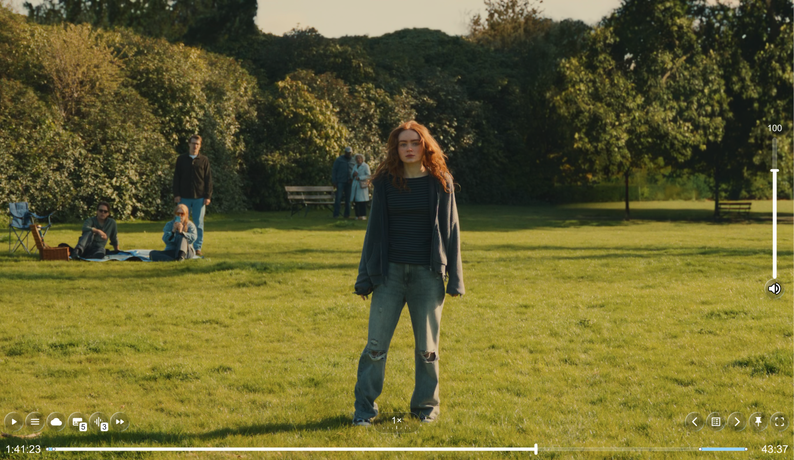
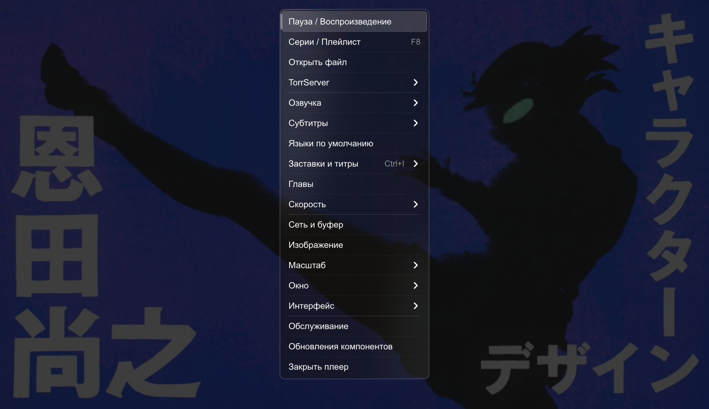
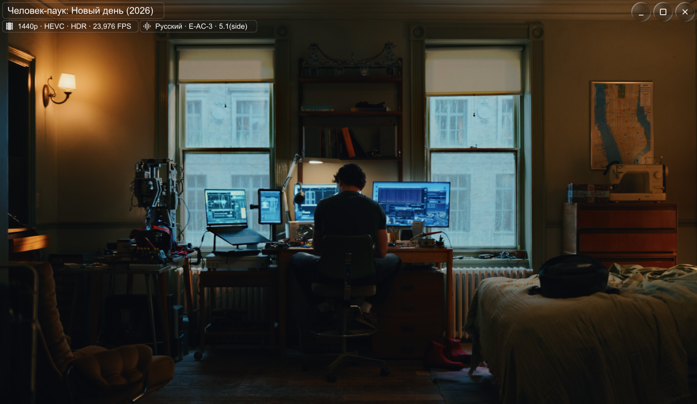

# mpv+ для Windows

Готовый плеер для Windows 10/11 x64: русское меню, пропуск заставок, TorrServer и выбор оформления.

## Скачать и запустить

<!-- release-downloads:start -->
**Актуальная версия: [1.1.0](https://github.com/Notme-SI/mpv-plus/releases/tag/v1.1.0) · Windows 10/11 x64**

| Система | Установщик | Портативная версия |
| --- | --- | --- |
| Windows 10/11 x64 |  |  |

Установщик — установка с выбором папки и созданием ярлыков. Портативная версия — запуск из распакованной папки.

[Все выпуски](https://github.com/Notme-SI/mpv-plus/releases) · [Изменения](https://github.com/Notme-SI/mpv-plus/releases/tag/v1.1.0) · [Контрольные суммы](releases/1.1.0/SHA256SUMS.txt)
<!-- release-downloads:end -->

1. Скачайте **Setup** и установите плеер. Либо распакуйте **Portable** целиком.
2. Запустите `mpv+.exe` и перетащите видео в окно.

## Подключить к Lampa

В настройках внешнего плеера Lampa выберите `mpv.exe` из папки mpv+. После этого запускайте фильмы из Lampa как обычно.

**Мост для обычного просмотра не нужен.** Плеер сам ищет названия и таймкоды по данным файла и TorrServer. Дополнительный мост передаёт сведения карточки из поддерживаемой версии Lampa Desktop — [когда нужен и как подключить](docs/BRIDGE.md).

Для списка раздач в меню самого плеера откройте **Обслуживание → Настроить TorrServer** и укажите свой сервер. Для запуска видео из Lampa эта настройка не обязательна.

## Управление

- Правая кнопка мыши — меню; пробел — пауза.
- `F8` — плейлист; `F9` — озвучка.
- `Ctrl+I` — пропуск заставок и титров; `Alt+A` — автопропуск.
- Булавка или `Alt+P` — поверх всех окон.

Плашка пропуска появляется за секунду до фрагмента. После автопропуска остаётся на **3 секунды**; при ручном пропуске исчезает сразу после нажатия. Таймкоды доступны не для всех видео и могут отличаться между раздачами.

## Обновить

Закройте плеер и установите новый Setup в прежнюю папку. Личные настройки сохраняются. Для Portable перенесите настройки в новую распакованную папку по [инструкции](docs/USAGE.md).

## Скриншоты

<table>
  <tr>
    <td> Панель воспроизведения</td>
    <td> Меню настроек</td>
  </tr>
  <tr>
    <td> Сведения о медиафайле</td>
    <td> Пропуск заставки</td>
  </tr>
  <tr>
    <td> Панель воспроизведения</td>
    <td> Плейлист</td>
  </tr>
</table>

[Руководство и решение проблем](docs/USAGE.md) · [Изменения](CHANGELOG.md) · [Сборка](BUILD.md) · [Источники](SOURCES.txt) · [Лицензии](LICENSE)

Неофициальная сборка [mpv](https://mpv.io/). Сторонние компоненты сохраняют свои лицензии; самостоятельные дополнения — MIT.
